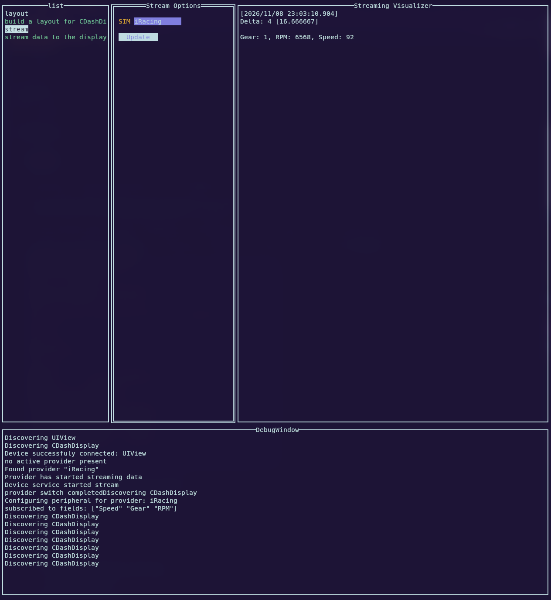

# ESDI
ESDI stands for "ESilva Desktop Interface" iirc, or "rAcElaBs aT hOmE"

This tool collects data from popular racing simulators (for now), to pass it to
peripherals (or a peripheral, only made one so far). This is the currently
available peripheral: [CDashDisplay](https://github.com/ESilva15/CDashDisplay).

If anyone finds this project useful for anything at all it would be pretty cool.
My main goal is to learn and have some fun.

## Usage
To launch the software, compile (TBD) or just run it with: `go run . tui`

You should see something like this:

The current behaviour is very opaque.

What is happening in the background is the software looks up for the configured
devices and for available telemetry providers.

Once it finds a device, in this case the CDashDisplay, it will try to configure 
it against the available telemetry provider.

After configuring it it will automatically start streaming data from the 
telemetry provider into the CDashDisplay.

Using the `arrows` you can navigate to the `stream` item on the list and then
go to the update button and press `s` to see the output on the terminal.

I upgraded the backend significantly and there's plenty of work to be done on
the frontend. I know its quite bad right now.

## Compatibility:
Games implemented so far:
- [iRacing](https://www.iracing.com/) using the [goirsdk](https://github.com/ESilva15/goirsdk)
- [BeamNG.drive](https://www.beamng.com/game/) using the [gobngsdk](https://github.com/ESilva15/gobngsdk)

Peripherals:
- [CDashDisplay](https://github.com/ESilva15/CDashDisplay)

<!-- Games being implemented: -->
<!---->
<!-- Games to be implemented: -->
<!-- - [Assetto Corsa](https://assettocorsa.gg/) -->

## Development
### Mockservers
I'm using a mockserver developed by myself that pretty much mimicks the telemetry
output from the actual simulators. It uses the SDKs I developed to do so with the
added bonus of being able to run the project on Linux and mainly develop it.

Just go to [TelemetryMockserver on GitHub](https://github.com/ESilva15/TelemetryMockserver) and follow
the instructions there.

### Troubleshooting
#### Can't see BeamNG data coming through
Use, for example, `tcpdump -i any udp port <port> -X` to check if any data is available.

### Debugging
#### Freezes:
Using delve:
- Launch Terminal1 with `dlv debug . --headless --listen=:2345 -- tui`
- Launch Terminal2 and connect to with with `dlv connect :2345`
- Type `continue` onto Terminal2 and go to Terminal1 to use the application
normally until it hangs.
- Go back to Terminal2 to and do a `Ctrl+c` to capture the state and then check
what went wrong by looking at the `goroutines` for example.

pprof:
- `go tool pprof http://localhost:8001/debug/pprof/mutex`
  - type `top` to view the summary
  - type `web` to view a graph version

## Shameless begging
Hey, doesn't hurt to try, its free either way:
[Buy me a coffee!](buymeacoffee.com/ESilva_15)
